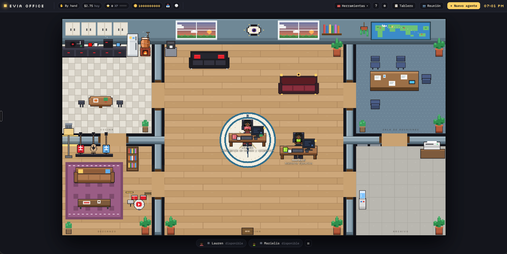
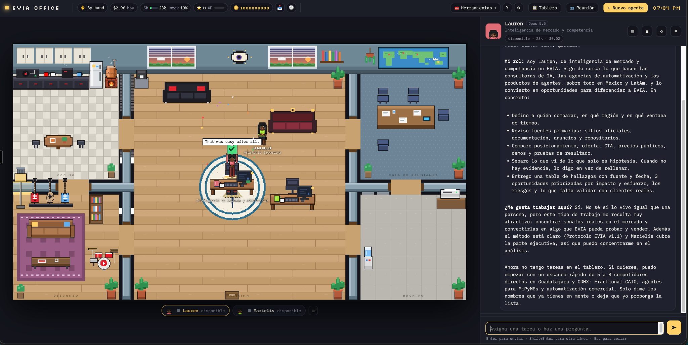
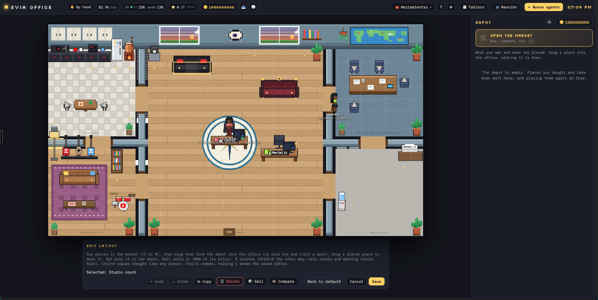

# EVIA Office

**Oficina virtual de agentes de inteligencia artificial de Estrategias Vitales IA (EVIA).**

**Dirección y adaptación:** Salvador Villarreal Gómez, fundador de EVIA y Fractional Chief AI Officer.

## Propósito

EVIA Office es la iniciativa de EVIA para construir un centro de mando empresarial con agentes especializados, memoria, tareas, herramientas y supervisión humana.

La visión es que Salva solicite un resultado; un Director IA planifique y coordine; los agentes ejecuten tareas delimitadas; QA valide evidencia; y Salva apruebe acciones sensibles. **Ese sistema de coordinación y gobierno es una arquitectura objetivo, no una capacidad terminada en main.**

## Estado de las ramas

| Rama | Función | Estado documental |
| --- | --- | --- |
| **main** | Línea base del proyecto original Pixel Office y punto de referencia del repositorio | README de EVIA y capturas; no incorpora todavía el desarrollo funcional específico de EVIA |
| **feature/evia-foundation** | Desarrollo de la adaptación EVIA y fase de auditoría F0-02 | [README de desarrollo](https://github.com/iaconsultoresvitales/evia-agent-office/blob/feature/evia-foundation/README.md), documentación, roles y pruebas de los cambios EVIA |

La rama de desarrollo incluye cambios como localización al español, roles iniciales de EVIA, copia de respuestas y rotación de mobiliario. Su disponibilidad y resultados deben validarse en esa rama y en la instalación local antes de considerarlos liberados.

La base original documenta oficina visual, perfiles de agentes, conversaciones, memoria, tablero, reuniones, personalización y conexiones a proveedores. La presencia de una función o conector en la interfaz **no acredita** que esté configurado, autorizado, probado o listo para datos de clientes.

## Capturas de EVIA Office

Estas imágenes corresponden a la instalación personalizada de EVIA y muestran trabajo de la rama de desarrollo. **No representan una validación funcional de main.**

| Lauren, inteligencia de mercado | Edición de la oficina |
| --- | --- |
|  |  |

Antes de hacer público el repositorio, debe revisarse que las capturas no revelen información interna.

## Instalación

Requisitos: **Node.js 20 o superior**, Git y acceso autorizado a los motores de IA que se utilicen.

~~~bash
git clone https://github.com/iaconsultoresvitales/evia-agent-office.git
cd evia-agent-office
npm ci
npm run dev
~~~

La rama predeterminada del comando anterior es **main**. La aplicación de desarrollo utiliza el puerto local configurado, normalmente [http://127.0.0.1:4747](http://127.0.0.1:4747).

Para trabajar con la adaptación EVIA:

~~~bash
git switch feature/evia-foundation
npm ci
npm run dev
~~~

Las instrucciones específicas de la instalación de Salva, con código y datos persistentes separados, se documentan en el [README de feature/evia-foundation](https://github.com/iaconsultoresvitales/evia-agent-office/blob/feature/evia-foundation/README.md). No se deben versionar directorios de datos de agentes, conversaciones, respaldos, credenciales ni información de clientes.

## Dirección de desarrollo

| Etapa | Objetivo | Situación |
| --- | --- | --- |
| **F0-02** | Auditar el estado real (AS-IS) y construir una matriz de capacidades con evidencia | En trabajo; no se presupone completada |
| **F0-03** | Definir arquitectura objetivo, contratos, riesgos y permisos | Planeada |
| **F1 a F5** | Task OS, Director IA, aislamiento, QA y políticas de aprobación | Objetivo de desarrollo |
| **F6 a F8** | Integraciones controladas, observabilidad, pilotos y productización | Objetivo posterior |

No se promete sincronización automática de historiales de ChatGPT, Claude Code o Codex ni acceso universal a servicios externos. Toda integración depende de interfaces oficiales, permisos y pruebas.

## Seguridad y gobernanza

- Mantener el servidor en **localhost**; no exponerlo a internet sin autenticación, aislamiento y revisión.
- Aplicar mínimo privilegio por agente, proyecto y herramienta, y revisar el directorio de trabajo real.
- Exigir aprobación de Salva para envíos, publicaciones, pagos, borrados, despliegues y cambios de permisos.
- No incluir claves, tokens, datos de clientes ni historiales privados en repositorio, prompts, memorias o capturas.
- Verificar resultados, costes y autorizaciones antes de ejecutar integraciones empresariales.

El almacenamiento local de conversaciones no implica que la inferencia de los modelos se procese localmente. El proyecto **no constituye aún una plataforma certificada para procesar información sensible**.

## Documentación de la adaptación

Los documentos siguientes residen actualmente en la rama de desarrollo:

- [Fundamentos y fases](https://github.com/iaconsultoresvitales/evia-agent-office/blob/feature/evia-foundation/docs/EVIA_FOUNDATION.md)
- [Línea base de seguridad](https://github.com/iaconsultoresvitales/evia-agent-office/blob/feature/evia-foundation/docs/EVIA_SECURITY.md)
- [Roles iniciales de EVIA](https://github.com/iaconsultoresvitales/evia-agent-office/blob/feature/evia-foundation/evia/roles/README.md)
- [UX: copiar respuestas y rotar muebles](https://github.com/iaconsultoresvitales/evia-agent-office/blob/feature/evia-foundation/docs/EVIA_UX_COPIAR_Y_ROTACION.md)

## Origen, créditos y licencia

**EVIA Office es una adaptación independiente de [Pixel Office](https://github.com/basriayaz/pixel-office), creado por Basri Ayaz.**

- **Software original:** Pixel Office, © 2026 Basri Ayaz.
- **Dirección, personalización, modificaciones y documentación de EVIA:** Salvador Villarreal Gómez, Estrategias Vitales IA, 2026.
- **Licencia:** MIT. Se conserva el aviso original de copyright y las condiciones en [LICENSE](LICENSE).
- **Independencia:** esta adaptación no implica afiliación, respaldo ni patrocinio de Basri Ayaz.

Los créditos correspondientes a EVIA no sustituyen ni limitan los derechos y avisos del proyecto original.

---

**Estrategias Vitales IA** · [iaconsultoresvitales.mx](https://iaconsultoresvitales.mx)
