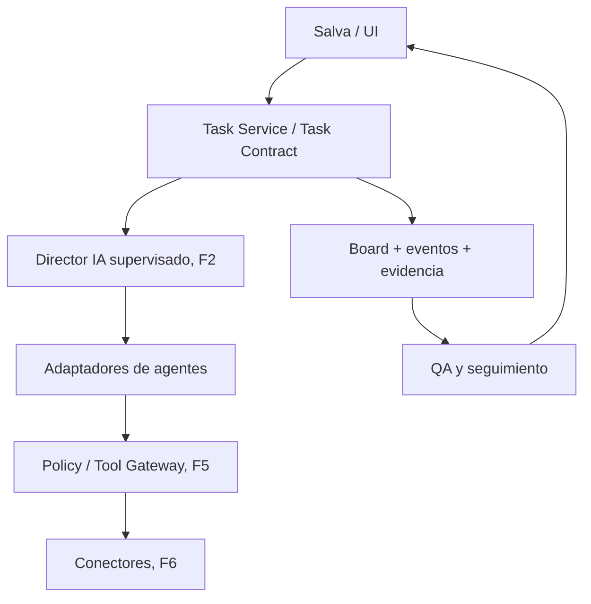

# EVIA Office OS | F0-03 | Diseño TO-BE y contratos v0.1

**Estado:** PROPUESTA PARA REVISIÓN. No son ADR aceptados ni autorización para implementar.  
**Fecha:** 4 de noviembre de 2026.  
**Dependencia:** [F0-02 AS-IS](F0-02-AS-IS.md), aceptada como línea base para diseño mediante «vamos, sigamos» de Salva.  
**Base de código:** commit `5033cfb28529395e28e9e0dd47c6b19bcf7904df`.  
**Próxima fase, si se aprueba este diseño:** F1, Task OS mínimo.

> **Principio de arquitectura:** aprovechar el tablero, archivos persistentes, eventos, sesiones y adaptadores ya implementados en Pixel Office. Diseñar una capa mínima de contratos verificables sobre ellos. El Director IA vendrá después de que Task OS pueda gestionar una tarea reproducible con evidencia. No reconstruir la aplicación ni agregar un segundo stack sin una brecha demostrada.

## 1. Objetivo, problema y límites

**Objetivo empresarial:** convertir solicitudes de Salva en tareas verificables por agente, proyecto, estado, límites y entregables, preparadas para operación empresarial sin hacer pasar una respuesta de chat por resultado ejecutado.

**Problemas AS-IS prioritarios:**

1. `board.ts` implementa estados, responsables, notas y dependencias, pero no un Task Contract empresarial completo ni transiciones centralizadas con evidencia de cumplimiento.
2. Existen proveedores y perfiles de agentes, pero no un Director IA que produzca un plan, asigne contratos y supervise cierre verificable.
3. Historial, runs, eventos y memoria están implementados, pero no existe una separación empresarial completa por proyecto/cliente.
4. La aprobación de acciones y los permisos dependen de cada motor; todavía no existe un contrato uniforme de aprobación por acción/destino.

**No objetivos de F0-03:** escribir código funcional, instalar plataformas, iniciar sesión en proveedores, conectar cuentas de clientes, redesplegar la oficina, endurecer namespaces/AppArmor, añadir avatares, implementar Policy Engine o automatizar envíos. Todo eso se deja a las fases correspondientes.

## 2. Mapa de reutilización

| Componente existente | Evidencia AS-IS | Reutilización propuesta | Brecha que queda |
| --- | --- | --- | --- |
| `src/server/board.ts` | `Task` con `id` numérico, `owner`, `status`, `after`, `review`, notas y archivo persistente | Fuente primaria del estado de tareas F1 | Añadir contrato opcional y validar transiciones de tareas gestionadas |
| `src/server/events.ts` | Eventos en JSONL | Registrar cambios de estado y razón con correlación | Evidencia y correlación contractual |
| `src/server/runs.ts` | Ejecuciones, duración, estatus y costos | Adjuntar resultado a un contrato de tarea | Identificar intentos/reintentos y su evidencia |
| `src/server/store.ts` y `fsutil.ts` | Historial, escritura atómica, respaldos y recuperación | Conservar persistencia local-first sin introducir base de datos ahora | Separación de memoria y migración compatible |
| `src/server/employee.ts` | Sesiones y colas de empleados con motores heterogéneos | Ejecutores de tareas concretas de F2 | Contrato uniforme de input/output y supervisión |
| `src/server/providers.ts`, `codex.ts`, `gemini.ts` | Adaptadores por proveedor | Adaptadores bajo interfaz única de ejecución | Presupuestos, resultados y permisos homogéneos |
| `src/server/evia-roles.ts` | Cuatro plantillas EVIA en modo `plan` | Fuente para configurar agentes F2 | Activación, rol contractual y QA reales |
| `src/server/integrations.ts`, `skills.ts` | Catálogos e integración MCP existente | Tool Gateway F5/F6 | Aprobaciones, scopes y ejecución verificada |

**Restricción de compatibilidad:** conservar inicialmente los estados de UI y tablero `todo → doing → review → done`, además de `blocked`. No renombrar ni migrar masivamente datos históricos durante F1.

## 3. Arquitectura objetivo incremental



**Nota:** las cajas marcadas F2/F5/F6 son objetivo, no módulos ya terminados. El MVP F1 se concentra en `Task Service`, contratos, estados, persistencia y evidencia básica, sin ejecutar conectores externos.

### Separación de responsabilidades

| Actor/componente | Puede | No debe hacer en la primera implementación |
| --- | --- | --- |
| Salva | Solicitar, aprobar, rechazar, revisar evidencia | Perder visibilidad del destino o efecto de una acción |
| Task Service F1 | Crear/actualizar tareas, validar estados, dependencias y evidencia | Invocar por sí mismo herramientas externas |
| Director IA F2 | Proponer planes y tareas, delegar conforme contratos y supervisar | Heredar permisos de agentes o saltarse aprobaciones |
| Agente ejecutor F2 | Trabajar dentro de su contrato y devolver resultado/evidencia | Usar permisos de otro proyecto/cliente |
| QA F4 | Comprobar fuentes, criterios y calidad | Declarar una tarea terminada sin evidencia |
| Tool Gateway F5 | Verificar alcance y aprobación y registrar efecto | Ejecutar escrituras no autorizadas |

## 4. ADR propuestos: decisiones a someter a Salva

| ADR | Recomendación | Alternativa considerada | Ventaja | Riesgo o costo | Estado |
| --- | --- | --- | --- | --- | --- |
| **ADR-F003-01** Persistencia | Conservar JSON/JSONL y guardado atómico para F1, con cambios compatibles | Introducir SQLite desde F1 | Menos migración y menor tiempo de desarrollo | Las escrituras entre varios archivos no forman una transacción única; diseñar reconciliación | **PROPUESTA** |
| **ADR-F003-02** Task Contract | Agregar campos opcionales versionados al `Task` actual, con `Task Service` que valide tareas gestionadas | Nueva base de tareas paralela o reemplazar tablero | Una fuente de estado y UI existente reutilizable | Cambiar rutas y eventos exige tests de regresión | **PROPUESTA** |
| **ADR-F003-03** Director IA | Orquestador mínimo sobre Task Service con acciones de planificación y delegación trazables | Agente libre que llame directamente cualquier herramienta | Supervisión, QA y reanudación comprobables | Requiere disciplina de contrato por tarea | **PROPUESTA** |
| **ADR-F003-04** Gobierno | Definir contratos de herramientas/aprobaciones ahora; implementar controles progresivamente en F5 | Integrar conectores de escritura desde F1 | Evita mezclar diseño con credenciales reales | Hay que mantener explícito lo que aún no está protegido | **PROPUESTA** |

**Criterio de decisión:** aprobar estas recomendaciones solo si reducen duplicación, son compatibles con la base existente y facilitan el primer workflow empresarial. No introducir SQLite, colas distribuidas ni OpenShell sin necesidad demostrada.

## 5. Contratos mínimos propuestos

Los siguientes ejemplos son **esquemas de diseño** (v0.1), no interfaces TypeScript ya compiladas. Los identificadores y límites son ilustrativos. Ningún ejemplo autoriza acciones reales.

### 5.1. Task Contract v1 (F1)

```json
{
  "schemaVersion": 1,
  "officeId": "evia-office",
  "taskId": 42,
  "projectId": "evia-radar",
  "title": "Investigar un competidor",
  "objective": "Entregar un resumen verificable",
  "ownerAgentId": "radar-competitivo",
  "requestedBy": "salva",
  "status": "todo",
  "dependsOn": [],
  "inputRefs": [{ "ref": "fixture:competidor-01", "trusted": false }],
  "deliverables": [{ "kind": "markdown", "name": "resumen" }],
  "acceptanceCriteria": ["Afirmaciones con fuente", "Distingue hechos e inferencias"],
  "scope": { "readPaths": ["fixtures/"], "writePaths": [] },
  "limits": { "maxSteps": 6, "maxRetries": 1, "maxDurationSeconds": 300 },
  "evidenceRefs": [],
  "approvalRequired": false
}
```

**Invariantes F1:**

- `officeId + taskId` identifica la tarea en su ámbito; no equiparar ID numérico local con ID global entre oficinas.
- `projectId` es obligatorio para **tareas nuevas gestionadas**. Las tareas anteriores siguen legibles sin migración inmediata.
- El contrato es versionado, validable y no contiene secretos; `inputRefs` externos se tratan como datos no confiables.
- Una transición válida conserva responsable, criterios, límites y vínculos de evidencia; cambios relevantes se registran como eventos.
- La ausencia de evidencia impide cerrar una tarea gestionada que requiera revisión; las tareas heredadas siguen su comportamiento actual hasta migración explícita.

### 5.2. Agent Contract v1 (F2)

```json
{
  "agentId": "radar-competitivo",
  "roleTemplate": "evia/roles/radar-competitivo/agent.md",
  "projectId": "evia-radar",
  "responsibilities": ["investigacion", "resumen_con_fuentes"],
  "toolScopes": ["workspace-read"],
  "inputTaskRef": "evia-office:42",
  "output": { "artifactRefs": [], "evidenceRefs": [], "status": "review" },
  "resourceLimitsRef": "task:evia-office:42"
}
```

Un perfil del catálogo solo propone instrucciones. Para operar como agente debe existir un contrato ligado a una tarea y proyecto. **No equivale a un nuevo proveedor ni a una API activada.**

### 5.3. Tool Contract v1 (diseño F0-03; ejecución F5/F6)

```json
{
  "toolId": "crm.contacts.read",
  "effect": "read",
  "provider": "adapter-id",
  "projectId": "evia-radar",
  "resourceScope": "contacts:test-fixture",
  "inputSchemaRef": "schema:crm-contacts-read-v1",
  "outputSchemaRef": "schema:contacts-v1",
  "requiresApproval": false,
  "auditRequired": true
}
```

`effect` se clasifica en `read`, `draft` o `write`. Un permiso de lectura no autoriza escritura. Los tokens, si algún día se usan, viven fuera del contrato y no se copian a prompts ni logs.

### 5.4. Approval Contract v1 (diseño F0-03; ejecución F5)

```json
{
  "approvalId": "approval-001",
  "taskRef": "evia-office:42",
  "requestedBy": "director-ia",
  "approver": "salva",
  "action": "crm.contacts.update",
  "destination": "contact:test-123",
  "preparedPayloadDigest": "sha256:example-only",
  "status": "pending",
  "expiresAt": "2026-11-04T23:00:00Z",
  "singleUse": true
}
```

La aprobación futura deberá corresponder a **acción, destino y contenido exactos**. Este diseño no implementa el control ni habilita cambios en CRM.

### 5.5. Evidence Reference v1 (F1 básico, F4 evaluación avanzada)

```json
{
  "evidenceId": "ev-001",
  "taskRef": "evia-office:42",
  "kind": "source-or-artifact",
  "ref": "fixture:competidor-01",
  "observedAt": "2026-11-04T17:00:00Z",
  "claim": "dato a verificar",
  "verification": "pending"
}
```

En F1 basta registrar referencias y su existencia; la evaluación de exactitud y calidad se implementará en F4. No almacenar textos de clientes ni respuestas completas duplicadas innecesariamente.

## 6. Máquina de estados Task OS

La UI ya utiliza cinco estados. **F1 mantiene sus nombres** y aplica validación adicional solo a tareas gestionadas por contrato, con compatibilidad para las anteriores.

| Desde | Hacia | Condición mínima propuesta | Evento / evidencia |
| --- | --- | --- | --- |
| `todo` | `doing` | Dependencias `after` resueltas, responsable asignado, límites definidos | `task_started`, actor y timestamp |
| `doing` | `review` | Entregable o explicación de bloqueo registrados | Referencias de resultado y run |
| `review` | `done` | Criterios de aceptación revisados y evidencia suficiente; actor autorizado | Aprobación de cierre y evidencia |
| `review` | `doing` | Corrección solicitada | Motivo, revisión y nueva ejecución |
| `todo/doing/review` | `blocked` | Error, dependencia faltante o límite alcanzado | Causa verificable |
| `blocked` | `todo` | Desbloqueo explícito y causa resuelta | Actor y motivo |

**Rechazar** transiciones inválidas en tareas gestionadas; no simular un `done` por avatar inactivo. Para el MVP empresarial, evitar cierre directo `doing → done` sin revisión. El tablero actual no garantiza por sí solo todas estas reglas: se introducirán en un servicio, con tests positivos y negativos.

## 7. Persistencia, reanudación y consistencia

**Propuesta F1:**

1. Extender de forma compatible el objeto `Task` con una sección opcional `contract` versionada. No reemplazar `board.json` ni introducir base de datos nueva en este hito.
2. Encapsular las nuevas operaciones empresariales en un `TaskService` que use el `Board` existente; migrar las llamadas necesarias de forma incremental, sin reescribir toda la aplicación.
3. Reutilizar escrituras atómicas y respaldos de `fsutil.ts` para datos de tareas; anexar eventos con referencia a contrato y operación.
4. Diseñar identificadores de operación para evitar creación/ejecución duplicada ante reintento. El registro en JSONL y la escritura del tablero no son una transacción conjunta: validar recuperación y reconstrucción, sin afirmar atomicidad total.
5. Al reiniciar, reconciliar contratos en `doing` contra registros de ejecución; no reejecutar a ciegas operaciones potencialmente externas.
6. Conservar los datos legados legibles y ofrecer una ruta de reversión del código sin borrar archivos de usuarios.

**Diseño de rutas:** el contrato guardará `projectId` y referencias de recursos. En F3 se hará efectivo el aislamiento de contextos y rutas por proyecto; hasta entonces, el piloto utilizará datos ficticios/locales, sin clientes reales.

## 8. Director IA mínimo (alcance futuro F2)

Una vez disponible Task OS:

1. **Interpretar:** convertir la solicitud de Salva en objetivo y criterios concretos.
2. **Planificar:** proponer tareas pequeñas y dependencias, con estimación acotada.
3. **Asignar:** seleccionar agente compatible sin asumir que está instalado o autorizado.
4. **Supervisar:** consultar estados, costos y evidencia; detectar bloqueos y reintentos.
5. **Escalar:** pedir decisión humana en operaciones sensibles o información insuficiente.
6. **Cerrar:** solicitar revisión de QA y ofrecer a Salva un resultado trazable.

Primer workflow a evaluar: **Salva → Director → Task OS → Lauren investiga → QA valida → Mariels prepara seguimiento → Salva aprueba → herramienta ejecuta → resultado se verifica y registra**. En F2 se puede usar un fixture de investigación sin envío real; las escrituras por conectores siguen reservadas a F5/F6.

## 9. Tickets de salida de F0-03 y siguiente implementación F1

| ID | Actividad | Entregable | Dependencia | Criterio de aceptación | Estado |
| --- | --- | --- | --- | --- | --- |
| F0-03-01 | Validar reutilización AS-IS y ADR | ADR-F003-01 a 04 con decisión | F0-02 baseline | Salva acepta o modifica cada decisión relevante | PROPUESTA |
| F0-03-02 | Definir contratos v1 | Task/Agent/Tool/Approval/Evidence schemas aprobados | F0-03-01 | Campos, versiones, límites y ejemplos claros | PROPUESTA |
| F0-03-03 | Definir transiciones, límites y permisos | Reglas para tareas gestionadas | F0-03-02 | Casos positivos/negativos y no-duplicación definidos | PROPUESTA |
| F0-03-04 | Acordar F1 mínimo y rollback | Backlog y QA de implementación | F0-03-03 | Plan pequeño, reversible y sin migración destructiva | PROPUESTA |
| F1-01 | Contrato opcional y validador | Tipo/esquema y pruebas unitarias | F0-03 aceptado | Legacy sigue funcionando; contratos inválidos se rechazan | NO INICIADO |
| F1-02 | TaskService y transiciones | Servicio + tests de estados/dependencias | F1-01 | Creación, avance, revisión, bloqueo y recuperación PASS | NO INICIADO |
| F1-03 | Evidencia y eventos | Referencias correlacionadas con tarea/run | F1-02 | Un cierre empresarial exige evidencia; logs coherentes | NO INICIADO |
| F1-04 | Reanudación y compatibilidad | Pruebas de reinicio, datos anteriores y rollback | F1-03 | Sin pérdida de datos y sin doble ejecución | NO INICIADO |
| F1-05 | QA completa del incremento | Build, tests, smoke, diff y documentación | F1-01 a 04 | Resultado revisable, sin merge/deploy automático | NO INICIADO |

### Pruebas de aceptación prioritarias F1

- **Positivas:** tarea nueva con contrato válido, dependencias satisfechas, transición a `review`, aprobación de cierre con evidencia, persistencia tras reinicio.
- **Negativas:** contrato sin proyecto, dependencia sin completar, transición inválida, cierre sin evidencia, reintento con misma operación, referencia a recurso fuera del ámbito permitido.
- **Regresión:** `npm test`, `node scripts/smoke.mjs`, lectura de tareas antiguas, historial previo intacto y UI sin cambios inesperados.
- **Rollback:** antes del cambio operativo, conservar copia verificable del estado de prueba. Revertir cambios de código sin destruir ni migrar irreversiblemente datos.

## 10. Riesgos y límites aceptados del diseño

| Riesgo | Tratamiento propuesto | Fase efectiva |
| --- | --- | --- |
| Duplicación de estado si se añade otra base | Extender Board opcionalmente, evitar segundo registro de tareas | F1 |
| Cambios de esquema afectan archivos legados | Campos opcionales versionados y tests de compatibilidad | F1 |
| JSONL y estado no son transacción única | Eventos correlacionados + reconciliación e idempotencia | F1/F7 |
| Un perfil IA se confunde con Director operativo | Agente de coordinación solo después del servicio probado | F2 |
| Mezcla de datos de clientes | Pruebas ficticias ahora; scopes y aislamiento efectivo en F3 | F3 |
| Permisos heterogéneos por proveedor | Política por contrato; sin escrituras reales antes de Tool Gateway | F5/F6 |
| Sobrecoste de controles de laboratorio | Evitar OpenShell/harness avanzado hasta evidencia de necesidad | Pospuesto |

## 11. Decisiones para Salva (máximo tres)

1. **Persistencia F1:** ¿confirmamos reutilizar JSON/JSONL y Board como línea de evolución, sin SQLite ahora? **Recomendación: sí.**
2. **Task Contract mínimo:** ¿confirmamos el contrato opcional versionado y las transiciones de tarea gestionada, manteniendo las tareas legadas? **Recomendación: sí.**
3. **Primer caso de aceptación:** ¿usamos investigación competitiva con datos ficticios y salida revisada por QA, sin conectores de escritura? **Recomendación: sí.**

Si se aprueban, se registran los ADR aceptados en un commit documental y se puede preparar F1-01. **La aprobación del diseño no equivale a autorización para usar cuentas reales, hacer merge o desplegar.**

## 12. Evidencia del diseño

- [F0-02-AS-IS.md](F0-02-AS-IS.md): línea base, pruebas, brechas y límites.
- [`board.ts` en commit probado](https://github.com/iaconsultoresvitales/evia-agent-office/blob/5033cfb28529395e28e9e0dd47c6b19bcf7904df/src/server/board.ts): estados, `Task`, notas y dependencias.
- [`events.ts`](https://github.com/iaconsultoresvitales/evia-agent-office/blob/5033cfb28529395e28e9e0dd47c6b19bcf7904df/src/server/events.ts), [`runs.ts`](https://github.com/iaconsultoresvitales/evia-agent-office/blob/5033cfb28529395e28e9e0dd47c6b19bcf7904df/src/server/runs.ts): registro y ejecución.
- [`store.ts`](https://github.com/iaconsultoresvitales/evia-agent-office/blob/5033cfb28529395e28e9e0dd47c6b19bcf7904df/src/server/store.ts), [`fsutil.ts`](https://github.com/iaconsultoresvitales/evia-agent-office/blob/5033cfb28529395e28e9e0dd47c6b19bcf7904df/src/server/fsutil.ts): persistencia y recuperación.
- [`employee.ts`](https://github.com/iaconsultoresvitales/evia-agent-office/blob/5033cfb28529395e28e9e0dd47c6b19bcf7904df/src/server/employee.ts), [`evia-roles.ts`](https://github.com/iaconsultoresvitales/evia-agent-office/blob/5033cfb28529395e28e9e0dd47c6b19bcf7904df/src/server/evia-roles.ts): ejecución y perfiles.
- [Instrucciones del proyecto EVIA Office OS v1.1](https://github.com/iaconsultoresvitales/evia-agent-office): misión, fases y requisitos proporcionados por Salva en la conversación; su existencia como archivo versionado no se afirma aquí.

---

**Estado del documento:** `F0-03 PROPUESTA v0.1`.  
**Estado de ADR:** cuatro decisiones propuestas, ninguna aprobada formalmente.  
**Próximo acto de decisión:** Salva confirma o ajusta las tres decisiones de la sección 11.  
**Fuera de alcance en este cambio:** código de producción, APIs reales, credenciales, PR, merge y despliegue.
